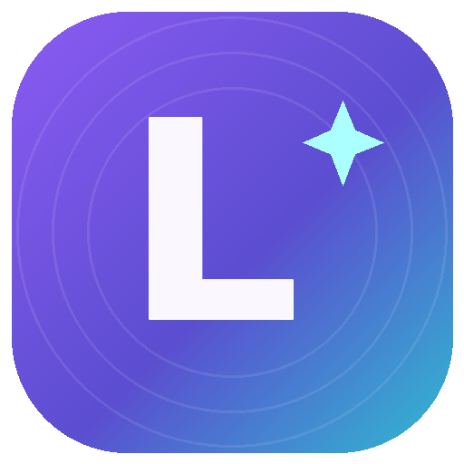

<div align="center">

# ✦ LokiVerse

**Your universe. Your tools. Your rules.**

Windows 10/11 desktop workspace • Offline-first • Free and open-source



[](https://github.com/LokiJ07/LokiVerse/actions/workflows/ci.yml)

</div>

## 💜 v0.3.0 — LokiShare (first working version)

**NEW: send files between your Windows PC and an Android phone using the same private Wi-Fi network, without cloud storage.** The phone opens a responsive local web interface in Chrome; **there is no separate Android APK in v0.3.0**.

| Module | What works |
|---|---|
| Overview | Dashboard, task summary, shortcuts |
| My Tasks | Categories, deadlines, priorities, local reminders while the app runs |
| LokiNotes | Markdown preview, folders, pinned notes, autosave |
| LokiFiles | Browse chosen folders, scoped search, duplicates, create and rename |
| SystemPulse | CPU/RAM graphs and disk information |
| **LokiShare** | Temporary LAN host, browser pairing, PC approval, 6-digit matching, QR/link, phone↔PC file transfer, live progress, file scope and disconnect |
| Settings | Themes, backup/restore, GitHub Release checker |

### How LokiShare works

1. Windows: Open LokiVerse → **LokiShare**. Choose the Wi-Fi or Ethernet IPv4 address (e.g. `192.168.1.5`) and click **Start sharing**. The phone and Windows computer must be on the same **private** LAN. If Windows Firewall asks, permit **Private networks only**.
2. Windows: To receive files, click **Choose receive folder**. To send files, click **Add files to share**. Only selected files can be downloaded; phone uploads go only into the chosen receive folder.
3. Android: Use the camera to scan the QR, **or** enter the displayed `http://...` address in Chrome and type the **10-character connection code** shown on Windows. The QR embeds a random one-session invite token.
4. Android: Tap **Request pairing** and look at the **6-digit verification number**. Windows: approve **only if the number matches**.
5. Android: **Choose files to send → Send**, or use **Save** beside the files explicitly shared by Windows. Transfers stay local; internet is not necessary.
6. Windows: View **Live activity**, disconnect devices individually or click **Stop sharing** to immediately terminate the session. Your workspace tasks and notes are never shared through this feature.

**Important security limitation:** v0.3.0 uses plain **HTTP** over the local Wi-Fi network. Pairing approval, random session credentials, input validation, and file selection restrict access, **but file contents are NOT encrypted in transit**. Use on **trusted private Wi-Fi only**; do not use shared/public/hotel Wi-Fi or send confidential files. A future release may add end-to-end encrypted transfers. Devices on different guest networks, client-isolated Wi-Fi, VPNs or blocked Windows Firewall settings may not connect.

**Limits:** 512 MiB per file. Browser uploads use file selection (no access to arbitrary Android directories). Downloads are limited to files explicitly selected by the Windows user. An incoming filename is validated and renamed if needed to avoid overwriting another file. Paired-device sessions expire after inactivity, and a Stop immediately revokes them. No cloud account, telemetry, or remote relay.

## 📦 Run locally

Requirements for development: Node.js 22+, internet for the initial `npm install` of Electron / QR code dependencies. Internet is **not required for local file sharing** after setup.

```bash
npm install
npm run check
npm start
```

Build an installer on Windows:

```bash
npm run dist:win
```

## 🤖 Upgrade an existing LokiVerse repository and installation

**Do not run `git init` or create a new GitHub repository.** If you currently have v0.2.1 installed:

1. Export your workspace backup from LokiVerse → Settings → Export.
2. Extract `LokiVerse-v0.3.0-Source.zip`. Copy **all files and folders**, including `.github` and the new `src/share-web`, into your existing local `LokiVerse` Git repository. Keep `.git` untouched.
3. Open Git Bash inside the existing repository:

```bash
npm install
npm run check
git add -A
git commit -m "feat: LokiVerse v0.3.0 LokiShare local transfer"
git push origin main
```

4. Wait until **LokiVerse Windows CI** succeeds in GitHub Actions.
5. **Only after a green CI run**, create the new tag:

```bash
git tag v0.3.0
git push origin v0.3.0
```

6. Wait until **LokiVerse GitHub Release** succeeds and download **`LokiVerse-0.3.0-Setup-x64.exe`** from the release assets.
7. Close the existing LokiVerse app. **Run the installer over your existing version; do not manually uninstall it.** Confirm the version, notes, tasks and settings are preserved.

The release workflow uses the repository-provided `GITHUB_TOKEN` and creates SHA256 checksums automatically. **No custom signing secret is required** for an unsigned NSIS release. Windows SmartScreen may warn about unsigned software. Check that the installer is from the official repository and verify its SHA256 checksum.

### Why upgrades preserve data

The app retains `build.appId = com.lokij.lokiverse`, `productName = LokiVerse`, the same NSIS per-user install mode, and the same `app.getPath('userData')` storage. **Never change these identifiers between releases.** Local data compatibility and storage recovery tests remain in the test suite. As always, test your Windows installer before announcing it to other users.

## 🧪 Tests

- `npm run check`: JavaScript syntax and Node test suite, including a real HTTP LAN pairing/upload/download simulation on loopback.
- Browser interface smoke tests were conducted with mocked desktop/browser APIs; Windows compilation, firewall access, QR rendering with the packaged dependency, and Android hardware transfer require real-world verification.
- No encrypted transport, automatic updates, automatic Android discovery, or native Android APK is claimed for v0.3.0.

## 🛡️ Privacy & safety

- Notes, tasks and settings stay on the computer unless explicitly exported; LokiShare does **not** expose the workspace backup or arbitrary PC directories.
- LokiShare is off by default and binds only to the selected local IPv4 interface when started.
- The phone must present a one-session connection code/QR token and receive approval on the PC.
- Uploaded files are bounded in size, filenames are restricted, and existing files are never overwritten.
- The temporary HTTP service has no encryption. Do not share on networks you do not control. Stop sharing when finished.
- The desktop UI uses Electron `contextIsolation`, sandboxed renderer and a narrow IPC bridge. JSON backups are plain text and should be protected separately.

## Stack & licensing

Electron • Node.js • Vanilla HTML/CSS/JS • npm `qrcode` • Windows NSIS • GitHub Actions / Releases

MIT License © 2026 LokiJ
